# VITAE & CO. — Strategic Diagnostic of a Premium DTC Pet Brand

> A consultant-grade analytical case study: turning 88K rows of raw ecommerce data into a board-ready growth strategy.

**Author:** Emma Larroze · Business Operations & Revenue Analytics
**Stack:** Python · pandas · matplotlib · cohort & LTV modeling · unit economics
**Type:** End-to-end analytical work sample (data → diagnostic → strategy)

---

## 📌 The Brief

VITAE & CO. is a premium direct-to-consumer pet brand selling aesthetic and longevity products (supplements, raw nutrition, grooming, lifestyle) into the US national market. The brand scaled to **~$8.0M GMV** across **~25,000 orders** and **4,200 customers** between 2023 and 2026.

The mandate, framed as a CEO would frame it to a new analyst or consulting team:

> *"We've grown fast, but blended CAC is creeping up and Q1 2026 contribution margin softened. Show me — with numbers — where to double down, where to cut, and what the next 12 months should look like."*

This repo is my answer: a structured, hypothesis-driven diagnostic that mirrors the analytical workpaper a Business Analyst or Consulting Associate would produce in the first weeks of an engagement.

> **Note on the data:** the dataset is **synthetic** — generated programmatically to be realistic and internally consistent (see [`src/generate_dataset.py`](src/generate_dataset.py)). This lets me showcase analytical method without using any confidential information. Realism was a design goal: unit economics, seasonality, segment behavior, and channel efficiency were all calibrated to plausible DTC benchmarks.

---

## 🧭 How I structured the analysis

I framed the diagnostic around the three questions the CEO actually asked, broken into five MECE workstreams:

| Workstream | Question answered |
|---|---|
| **1. Business Diagnostic** | What's really happening to revenue and margin? |
| **2. Customer & Growth** | Who are our best customers and how do we acquire more profitably? |
| **3. Product & Merchandising** | Which products build the brand vs dilute it? |
| **4. Operations & Experience** | Where are we leaking margin and goodwill? |
| **5. Strategic Recommendations** | What do we do, in what order, for what return? |

---

## 🔑 Headline Findings

1. **Revenue scaled 3.0x (2023→2024) then ~2.0x (2024→2025), but contribution margin compressed in early 2026** — growth was bought, not earned, and the efficiency is fading.
2. **The VIP Longevity segment is 9% of customers but 30% of revenue**, with a lifetime value of **$6,558 — 7x the Bargain Hunter segment.** We under-invest in the people who matter most.
3. **Subscribers are worth 2.1x non-subscribers** ($3,228 vs $1,556 LTV) and order nearly twice as often. Subscription is the single most important growth lever and it's under-penetrated.
4. **Channel efficiency varies 7x:** Email/Referral returns **8.0x ROAS** while Podcast Sponsorship barely breaks even at **1.1x**. Reallocating spend is the fastest margin win available.
5. **Lifestyle Buyers return at 11.6%** — nearly double the base rate — quietly eroding contribution margin in the highest-AOV category.

---

## 📊 Selected Analysis

### 1 · Revenue scaled, but margin tells the real story
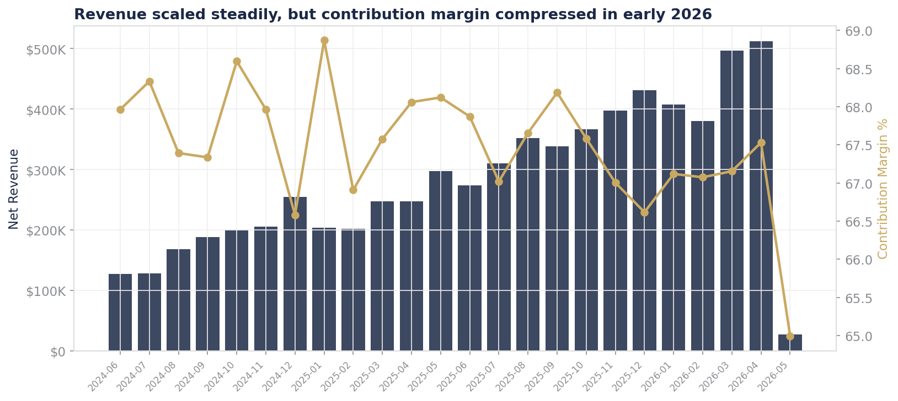

Net revenue climbed steadily, but the contribution-margin line reveals the issue the CEO sensed: profitability per dollar of revenue compressed even as the top line grew. **So what?** The growth engine is getting more expensive to run — the strategy work is about restoring efficiency, not just adding fuel.

### 2 · A small segment carries the business
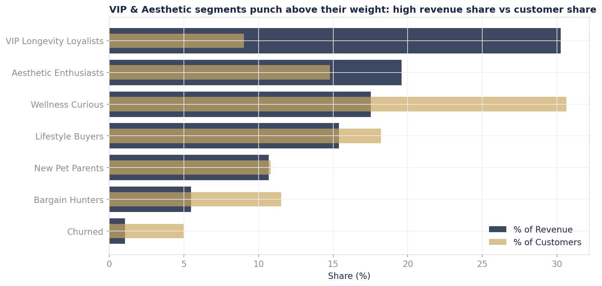
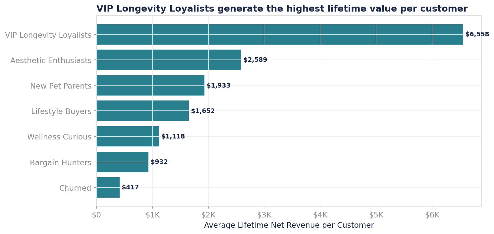

VIP Longevity Loyalists and Aesthetic Enthusiasts together are **24% of customers but 50% of revenue.** Their LTV dwarfs the rest. **So what?** Retention and expansion of these two segments should be the organizing principle of the marketing budget — not blanket top-of-funnel acquisition.

### 3 · Marketing efficiency varies wildly by channel
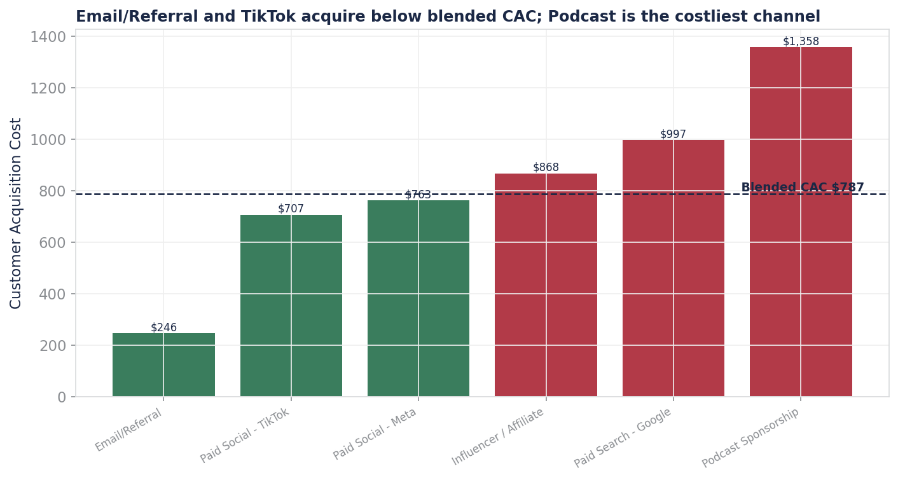

Email/Referral and TikTok acquire below blended CAC; Podcast and Paid Search sit well above it. **So what?** There is a defensible reallocation case: shift budget from the 1.1x ROAS channel toward the 8.0x channel and toward retention, with a quantified margin impact.

### 4 · Subscription is the flywheel
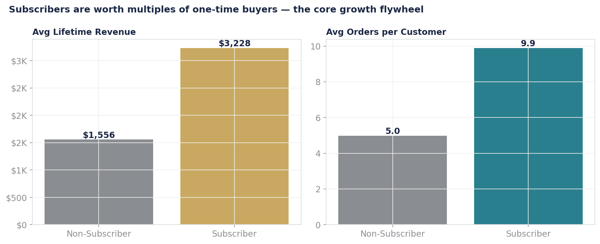

Subscribers generate **2.1x the lifetime value** of one-time buyers. **So what?** Converting even a modest share of high-intent one-time buyers into subscribers compounds — this is the highest-leverage retention play.

### 5 · The product portfolio, mapped
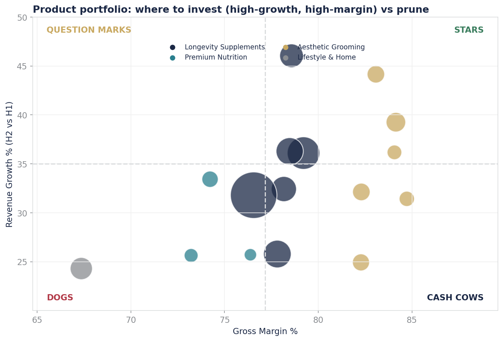
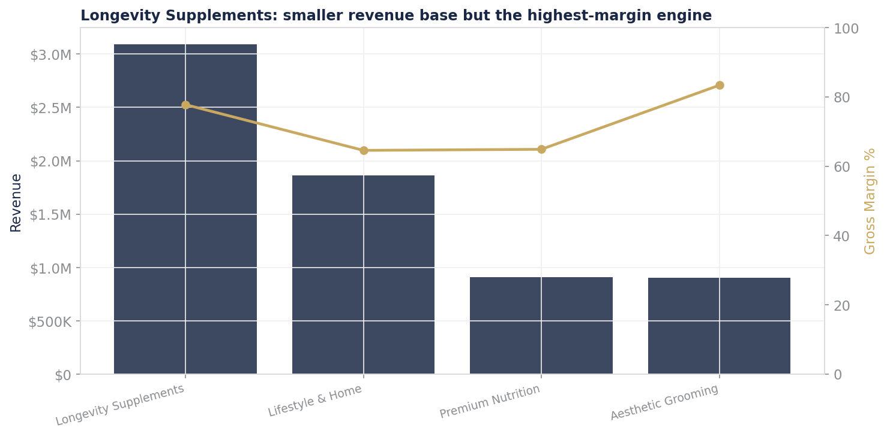

Longevity Supplements are a smaller revenue base but the **highest-margin engine (78% GM)**; Aesthetic Grooming is even richer at 83%. Lifestyle & Home drives AOV but dilutes margin. **So what?** Merchandising and bundling should pull customers toward the high-margin categories that also define the brand.

### 6 · Cohort retention reveals the leverage point
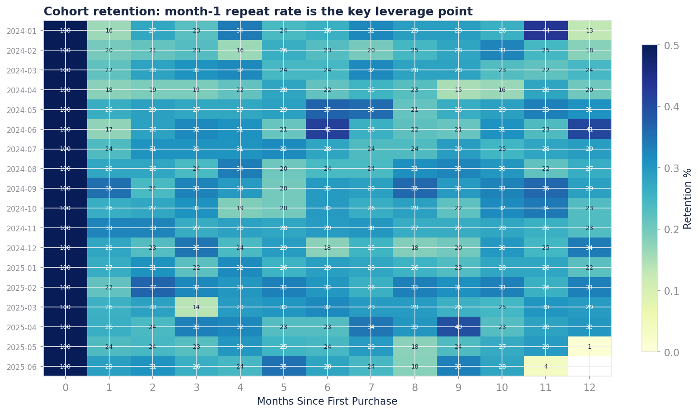

The month-1 repeat rate is the single biggest driver of cohort value. **So what?** A focused post-purchase and subscription-conversion effort in the first 30 days has an outsized effect on LTV.

### 7 · Operational margin leaks
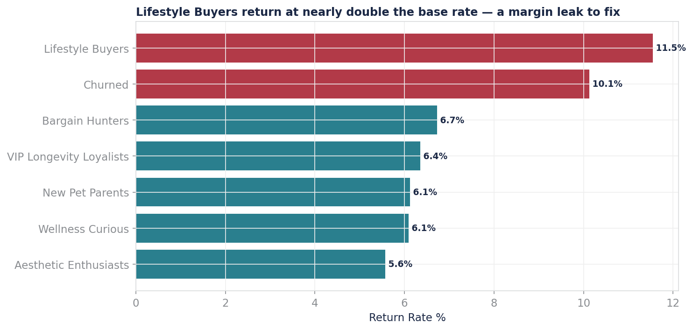
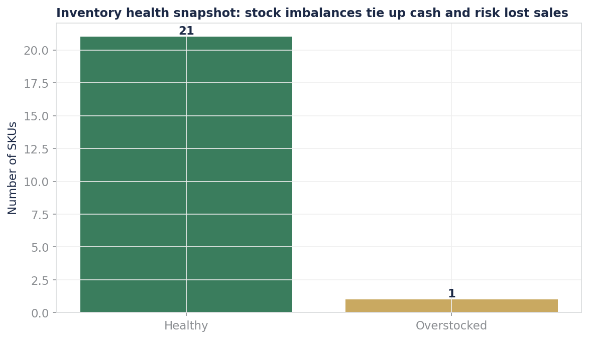
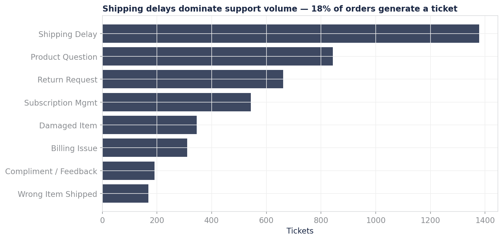

Lifestyle Buyers return at 11.6%, ~$56K of cash sits in overstock, and 18% of orders generate a support ticket (mostly shipping delays). **So what?** Each is a quantifiable, fixable contribution-margin leak.

---

## 🎯 Strategic Recommendations

Prioritized on an **Impact × Effort** basis. Full reasoning in [`docs/RECOMMENDATIONS.md`](docs/RECOMMENDATIONS.md).

| # | Initiative | Owner | Est. 12-mo impact | Effort |
|---|---|---|---|---|
| 1 | Reallocate ~20% of Podcast/Paid Search spend to Email/Referral + retention | Growth | +$180–260K margin | Low |
| 2 | Subscription conversion program targeting high-intent one-time buyers | Growth/CX | +$300–450K LTV | Medium |
| 3 | VIP & Aesthetic retention/expansion program | CRM | +$200–320K revenue | Medium |
| 4 | Reduce Lifestyle return rate by 2pts (sizing guides, packaging) | Ops/Merch | +$45–70K margin | Medium |
| 5 | Bundle entry SKUs toward high-margin Longevity category | Merch | +$120–180K margin | Low |
| 6 | Fix shipping-delay root cause (18% ticket driver) | Ops | +CSAT, -CX cost | Medium |

**Where to play / How to win:** Concentrate the next 12 months on the **VIP + Aesthetic customer × Longevity + Grooming category × Email/Referral + subscription channel** intersection — the brand's most profitable and most defensible core.

---

## 📁 Repo Structure

```
vitae-portfolio/
├── README.md                  ← you are here
├── data/                      ← the synthetic dataset (7 CSVs + combined XLSX)
│   ├── products.csv
│   ├── customers.csv
│   ├── orders.csv
│   ├── order_items.csv
│   ├── marketing_spend.csv
│   ├── inventory.csv
│   └── support_tickets.csv
├── notebooks/
│   └── vitae_strategic_diagnostic.ipynb   ← full analysis, runnable
├── src/
│   ├── generate_dataset.py    ← reproducible data generation
│   └── analysis.py            ← all metrics + figures
├── outputs/
│   ├── figures/               ← 12 publication-quality charts
│   └── metrics_summary.json   ← all computed metrics
└── docs/
    ├── DATA_DICTIONARY.md     ← every table and field documented
    ├── METHODOLOGY.md         ← assumptions, definitions, limitations
    └── RECOMMENDATIONS.md     ← full strategic write-up
```

---

## ▶️ Reproduce it

```bash
# 1. Install dependencies
pip install -r requirements.txt

# 2. (Optional) regenerate the synthetic dataset
python src/generate_dataset.py

# 3. Run the full analysis — regenerates all figures + metrics
python src/analysis.py

# 4. Or open the notebook to step through the analysis
jupyter notebook notebooks/vitae_strategic_diagnostic.ipynb
```

---

## 💡 Why this project

This is a deliberate demonstration of the analytical workflow I'd bring to a **Business Analyst, Business Operations, or Consulting Associate** role: framing an ambiguous business question, structuring it MECE, building the unit economics, validating assumptions against the data rather than trusting labels, and translating the analysis into prioritized, quantified recommendations a leadership team can act on.

What I'd do differently with real data: validate the segment definitions with the commercial team, pull true subscription churn from billing events rather than estimating it, and pressure-test the CAC attribution against a media-mix model.

---

*Built by Emma Larroze, 2026. Dataset is synthetic and for demonstration purposes only.*
